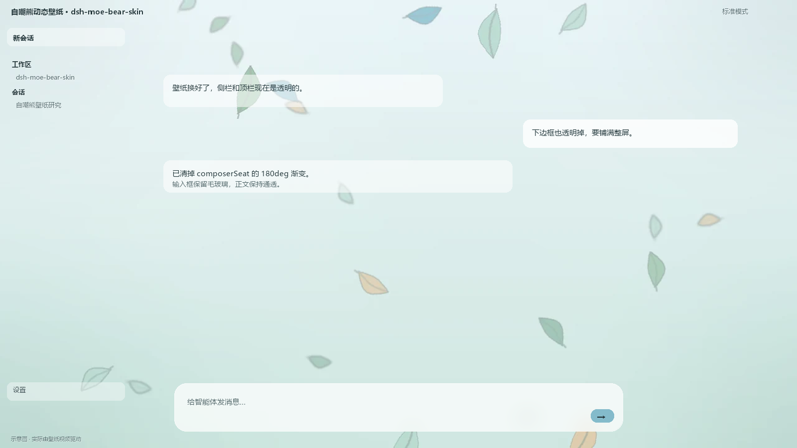
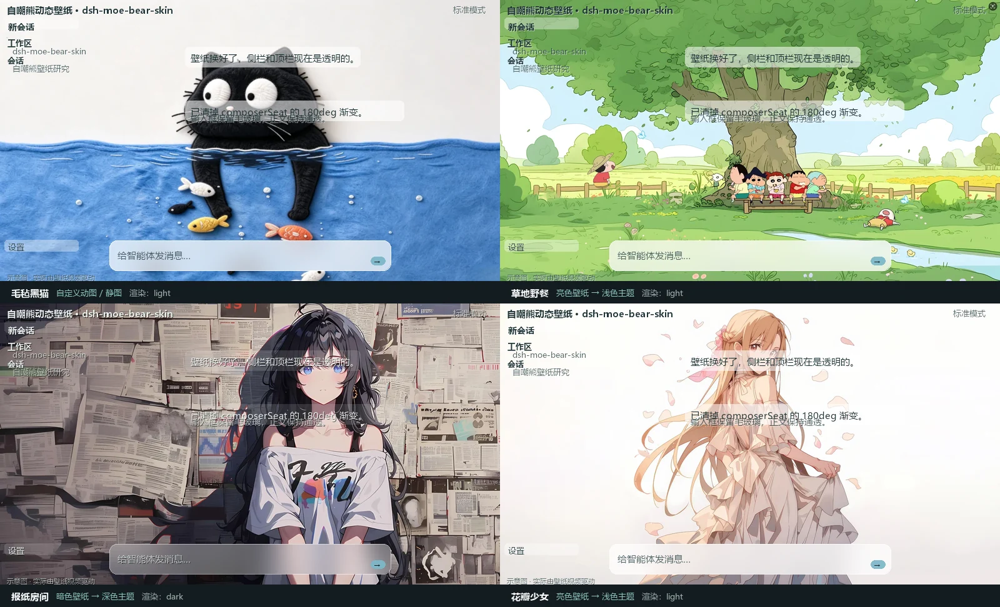
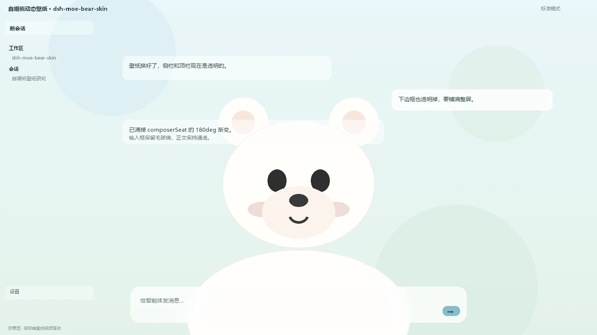

# dsh-moe-bear-skin

自嘲熊动态壁纸皮肤，为 [DeepSeek Harness](https://github.com/deepseek-ai/deepseek-harness)（DSH）桌面版 / Web 版准备的整屏壁纸皮肤。

[](https://github.com/bbbbbmy/dsh-moe-bear-skin/releases)
[](LICENSE)



> 以上都是 `tools/` 下脚本合成的示意图，**不含任何真实会话内容**；动态示意见 [docs/preview.gif](docs/preview.gif)。

- **开箱就有动态效果**：默认壁纸是本项目原创的「落叶」动效（`assets/leaf-fall.webp`，1280×720 动图 WebP，约 310 KB，无缝循环），随包分发、MIT 授权，不需要你自己准备素材。
- **整屏壁纸**：全窗口底层放一张动图或循环视频（`<video autoplay muted loop playsinline>`，`position: fixed; z-index: -2; object-fit: cover`），侧栏、顶栏、右栏、底部输入区全部透明，壁纸从窗口最上沿铺到最下沿。
- **零依赖、零构建**：没有 React，没有打包步骤。`lib/client.js` 就是最终可执行的浏览器 bundle，`git clone` 完即可用。
- **不会乱跳兜底**：`svgFallback` 默认 `false`——取不到素材时宁可留空，也不突然变成卡通熊；想开内置 SVG 小熊（呼吸 + 眨眼）就把 `wallpaper` 改成 `'bear'`。
- **毛玻璃只留一处**：输入框。侧栏/顶栏默认纯透明，可一键改回磨砂。
- **主题令牌**：浅色主色 `#7EB8C9`（雾蓝），深色 `#9CC2A8`（灰绿），通过 `ctx.theme.overrideTokens` 注入，跟随深/浅色切换。

## 更多效果



| 示例壁纸 | 说明 |
|---|---|
| **毛毡黑猫** | 亮色壁纸，浅色主题；侧栏顶栏完全透明，壁纸透到每一处 |
| **草地野餐** | 亮色壁纸，浅色主题；正文气泡几乎无底色，靠毛玻璃输入框收住视线 |
| **报纸房间** | 暗色壁纸自动配深色主题：壁纸压暗、文字转浅、主色换 `#9CC2A8` |
| **花瓣少女** | 亮色壁纸 + 大量留白，适合把窗口当画框用 |

这四个只是示例：把任意 mp4 / webp / gif 放进 `assets/`，`wallpaper` 填 `'video'` 或 `'image'` 就能得到同样效果。深浅配色跟着 Harness 的外观设置走，不用改皮肤。

**零素材兜底**：`wallpaper: 'bear'` 时不需要 `assets/`，直接用内置 SVG 小熊（会呼吸、会眨眼）：



> 示例壁纸由使用者提供，仓库仅用于展示效果，不主张其版权；想要可自由分发的一套请看自带的 `assets/leaf-fall.webp`（原创，MIT）。

```
┌───────────────────────────────────────────────┐
│  壁纸（video / img / SVG，cover 铺满）           │
│  ┌──────────┬──────────────────────────────┐  │
│  │ 侧栏      │  正文（透明，壁纸可见）         │  │
│  │ 透明      │                              │  │
│  │          │  ┌────────────────────────┐  │  │
│  │          │  │ 输入框（毛玻璃，可关）    │  │  │
│  └──────────┴──────────────────────────────┘  │
│  底部输入区同样透明（Harness 那道渐变被去掉）     │
└───────────────────────────────────────────────┘
```

## 安装

DSH 的插件是 **profile bundle**，装完需要重启（客户端 bundle 的字节在启动时快照，`Ctrl+R` 不够）。

```sh
# 从 GitHub 装（需要本机有 git）
dsh plugin --profile desktop add github:bbbbbmy/dsh-moe-bear-skin

# 或者直接指向本地目录（开发时用这条，改代码即时生效）
dsh plugin --profile desktop add link:/path/to/dsh-moe-bear-skin
```

`desktop` 换成你自己的 profile 名（`dsh web` 用 `web`）。装完**完全退出再打开** Harness。

> `file:` 与 `link:` 的区别：`file:` 会把包**复制**进 profile 的 `node_modules`（之后改源码不生效），`link:` 建的是 junction（软链，改源码立刻生效）。开发用 `link:`。

## 配置

所有可配置项集中在 `lib/client.js` 顶部的 `CONFIG`，CSS 由它生成，没有散落的魔法数字。

| 键 | 默认 | 说明 |
|---|---|---|
| `wallpaper` | `'image'` | `'image'`（含 `'gif'` 别名：用 assets/ 里的动图）/ `'video'` / `'bear'`（内置 SVG 小熊） |
| `wallpaperFile` | `'leaf-fall.webp'` | assets/ 里的文件名 |
| `wallpaperFallbacks` | `['bear-loop.mp4', 'bear-loop.webm']` | 上面那个找不到时依次尝试 |
| `wallpaperPoster` | `'leaf-fall-poster.webp'` | 动图/视频起播前的首帧占位 |
| `svgFallback` | `false` | 素材取不到时是否退回内置 SVG 小熊（`false` = 留空，不显示卡通熊） |
| `pauseWhenHidden` | `true` | 窗口不可见时暂停解码（省电） |
| `respectReducedMotion` | `true` | 系统开了「减少动态效果」时只显示静帧 |
| `portraitFile` | `''` | 立绘文件名；留空用内置线稿熊 |
| `portraitOpacity` | `0.26` | 立绘透明度 |
| `portraitPosition` | `'bottom-left'` | 或 `'bottom-right'` |
| `glassSidebar` | `false` | 侧栏要不要毛玻璃 |
| `glassTopbar` | `false` | 顶栏要不要毛玻璃 |
| `glassComposer` | `true` | 输入框要不要毛玻璃（`false` = 连输入框也透明） |
| `glassBlurPx` / `glassSaturate` | `18` / `1.25` | 毛玻璃强度 |
| `sidebarAlpha` / `topbarAlpha` | `0` | 侧栏/顶栏底色不透明度，`0.06~0.15` 可救回文字对比度 |
| `accentLight` / `accentDark` | `#7EB8C9` / `#9CC2A8` | 浅色/深色主色 |

## 换成你自己的壁纸

默认是随包分发的原创落叶动效（`assets/leaf-fall.webp`），想换就两步：

1. 把你的文件放进 `assets/`：

   ```
   assets/my-loop.mp4        循环视频（WebM 体积更小）
   assets/my-loop.webp      动图 WebP / GIF / APNG 都行（动图走 'image'）
   assets/my-poster.webp     首帧占位（可省）
   assets/my-bear.png        立绘（透明 PNG 最佳，可省）
   ```

2. 改 `CONFIG`：动图填 `wallpaper: 'image'`；视频填 `wallpaper: 'video'`。文件名不是默认值时再改 `wallpaperFile`（或加进 `wallpaperFallbacks`）。

3. 重启 Harness。

`.mp4 / .webm / .gif / .png` 等素材默认被 `.gitignore` 排除（只有自带的 `leaf-fall*` 例外），不会被误提交。

### 重新生成默认的落叶动效

```sh
python tools/make-wallpaper.py     # 需要 Pillow，输出 assets/leaf-fall.webp + poster
```

循环是精确无缝的：每片叶子的下落距离与自转圈数是帧数的整数倍，横摆周期也整除帧数，所以首尾能接上。改 `LEAF_COLORS` / `FRAMES` / `FPS` 即可换配色和节奏。

### `file://` 外壳的特殊情况

某些外壳用 `file://` 载入页面，此时浏览器取不到 `/moe-bear/assets/`，插件会退回内置 SVG（或留空）。想让壁纸在那种外壳里也出现，可以把一段视频 **内联进 bundle**：

```sh
node tools/inline-assets.mjs --file assets/my-loop.mp4   # 生成 base64，client.js 会变大
node tools/inline-assets.mjs --clear                      # 撤销
```

代价是 `lib/client.js` 会涨到十几 MB，所以默认不这么做。

## 工作原理

| 半边 | 文件 | 干了什么 |
|---|---|---|
| 宿主 | `lib/index.js` | 只做静态资源路由：`GET /moe-bear/assets/manifest.json` 返回 assets 文件清单，`GET /moe-bear/assets/<file>` 返回文件本体（后缀白名单、防目录穿越、`no-cache`）。等 `webServer` 服务就绪必须用 `ctx.inject(['webServer'], …)`——**不能在 `apply()` 里同步 `ctx.get('webServer')`**，`webserver` 这一行自己 `inject: [webStartup]`，比普通行晚就绪。 |
| 浏览器 | `lib/client.js` | 注入样式与三层 DOM（`[data-moe-layer="wallpaper"]`、`"scrim"`、`"portrait"`），用 `ctx.theme.overrideTokens` 覆盖 `--dsw-*` 令牌，用 `MutationObserver` 给语义锚点补 `.moe-glass`。 |

### 只用语义锚点，不写哈希类名

DSH 的类名带随机前缀（形如 `DuqLHW_sidebarCol`），所以选择器一律用 `[class*="_sidebarCol"]` 这种**后缀匹配**，或 Harness 自己声明过的 `data-*`：

| 目标 | 选择器 |
|---|---|
| 外壳 / 正文列 | `[class*="_frame"]`、`[class*="_centerCol"]`、`[class*="_leadingSeat"]` |
| 侧栏 / 右栏 | `[class*="_sidebarCol"]`、`[class*="_rightbarCol"]` |
| 顶栏 | `[data-windows-titlebar]` |
| 会话头部容器 | `*:has(> [data-conversation-header-leading])`（CSS 选不到父元素，用 `:has()`） |
| 底部输入区 | `[class*="_composerSeat"]`、`[class*="_composerStack"]`、`[class*="_composerHero"]`、`[data-composer-seat]` |
| 输入框 | `[data-composer-card]` |

Harness 改版时大概率只需要动这几个选择器。

> 底部那条「边框」其实是 `_composerSeat` 自带的一道
> `linear-gradient(180deg, transparent 0, var(--dsw-alias-bg-base) 36px)`（给滚动内容做遮罩用的），
> 本插件把它清掉，所以壁纸能一直铺到底。

## 卸载

```sh
dsh plugin --profile desktop remove dsh-moe-bear-skin
```

## 重新生成效果图

```sh
python tools/make-preview.py                     # 默认用 assets/leaf-fall-poster.webp，浅色主题
python tools/make-preview.py my-own.webp         # 换一张底图
python tools/make-preview.py --dark              # 深色主题（壁纸压暗 + 浅色文字）

python tools/make-examples.py                    # 四宫格示例 + 内置熊，读 docs/examples/ 里的壁纸
```

输出：

| 文件 | 内容 |
|---|---|
| `docs/preview.png` | 1600×900，默认壁纸 + 浅色主题 |
| `docs/preview.gif` | 800×450，16 帧推镜循环 |
| `docs/preview-gallery.webp` | 1600×972，四张示例壁纸 + 每格标题/主题/渲染方式 |
| `docs/preview-bear.webp` | 1600×900，`wallpaper: 'bear'` 的内置小熊 |
| `docs/examples/wallpaper-*.webp` | 四张 1600×900 示例壁纸（生成四宫格用） |

预览都是**合成示意图**：把壁纸当背景，按皮肤的真实样式叠加顶栏/侧栏/气泡/毛玻璃输入框，因此不会拍到任何人的会话内容。示例壁纸的深浅主题是按图片亮度自动选的（>0.55 走 light），和运行时切外观的行为一致；内置熊那张是用 Pillow 复刻 `WALLPAPER_SVG` 的同一套几何与配色，不是截屏。

## License

MIT（见 [LICENSE](LICENSE)）。内置的落叶动效（`assets/leaf-fall*`，由 `tools/make-wallpaper.py` 生成）与 SVG 小熊是本项目原创，可自由分发；你自己放进 `assets/` 的素材版权归你。
